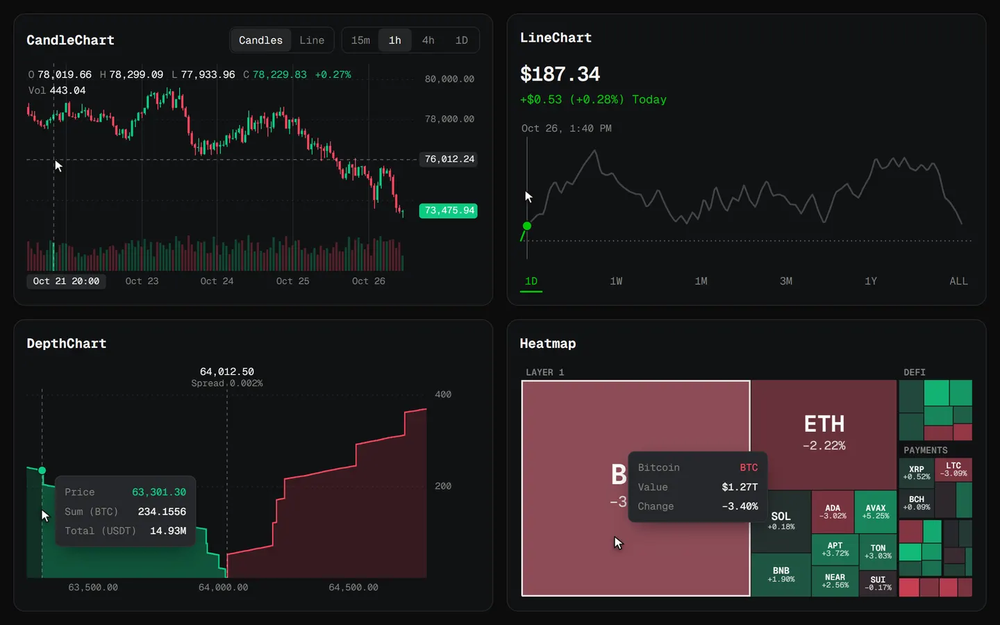

# charts

Four canvas charts for markets, written in plain TypeScript with no runtime dependencies. Each chart lives in its own folder and can be imported on its own.

Try the [charts on drk.vc](https://drk.vc/repo?id=charts#preview).



| Folder | Chart | What it shows |
| --- | --- | --- |
| [`candles/`](candles) | `CandleChart` | Candles or a close line with volume, a last-price tag and a crosshair. Zoom, pan and stretch the price axis. |
| [`line/`](line) | `LineChart` | One line coloured by whether it is up or down, with a hairline you drag across to read any point. |
| [`depth/`](depth) | `DepthChart` | Cumulative bids and asks stepping away from the mid price, with the total at any price on hover. |
| [`heatmap/`](heatmap) | `Heatmap` | A treemap sized by value and coloured by change, grouped by sector. Click a sector to zoom in. |

Every chart draws on a canvas at the screen's pixel ratio, repaints only while something moves, and reads its colours from CSS variables, so one stylesheet themes all four.

## Install

The package is not on npm. Install it from GitHub, which builds it on the way in:

```bash
npm install github:drkxbt/charts
```

Then import what you need and the shared stylesheet:

```js
import { CandleChart, LineChart } from "charts"; // everything
import { Heatmap } from "charts/heatmap"; // or one chart
import "charts/charts.css";
```

Each chart fills its container, so give the container a height.

## Usage

All four take a container and options, and have `redraw()` and `destroy()`:

```js
const chart = new CandleChart(document.querySelector("#chart"), {
  bars, // [{ time, open, high, low, close, volume }], time in seconds UTC
  label: "BTC/USDT, one hour candles. Scroll to zoom, drag to pan.",
});

chart.setBars(nextBars);
chart.destroy(); // removes listeners, observers and the canvas
```

The options, methods and controls for each chart are in its folder: [candles](candles#readme), [line](line#readme), [depth](depth#readme), [heatmap](heatmap#readme).

In React, create the chart in an effect and destroy it on cleanup:

```tsx
function Depth({ bids, asks }: { bids: Level[]; asks: Level[] }) {
  const ref = useRef<HTMLDivElement>(null);
  const chart = useRef<DepthChart>();

  useEffect(() => {
    chart.current = new DepthChart(ref.current!, { bids, asks, base: "BTC", quote: "USDT" });
    return () => chart.current?.destroy();
  }, []);

  useEffect(() => chart.current?.setBook(bids, asks), [bids, asks]);

  return <div ref={ref} style={{ height: 360 }} />;
}
```

## Theming

Colours and the font come from CSS custom properties, read on every paint. Set them on the container or any ancestor:

```css
:root {
  --chart-up: #0ecb81;
  --chart-down: #f6465d;
  --chart-accent: #ccff00;
  --chart-text: #f4f4f2;
  --chart-muted: #81817e;
  --chart-grid: rgba(255, 255, 255, 0.07);
  --chart-crosshair: rgba(255, 255, 255, 0.32);
  --chart-label: #2a2a2a;
  --chart-surface: #0b0b0c;
  --chart-font: ui-monospace, monospace;
}
```

After switching themes, call `redraw()` on each chart. A `theme` option overrides the variables for one chart.

## Accessibility

Every chart can take keyboard focus and uses its `label` as its accessible name, so write a label that says what the chart is and what the reader can do with it. Each one also works from the keyboard; the keys are listed in its folder. When the reader prefers reduced motion, zooms, morphs and glides jump straight to their end and the live dot stops pulsing.

## Demo

```bash
npm run demo
```

Then open http://localhost:4321/demo/ for all four charts with a light and dark theme, or http://localhost:4321/demo/tour.html for the looping tour the previews were recorded from. Add `?chart=candles`, `line`, `depth` or `heatmap` to the tour to show one chart. Everything in the demo is seeded sample data, not market prices.

## Layout

```
core/        canvas surface, render loop, theme, number formats
candles/     CandleChart
line/        LineChart
depth/       DepthChart
heatmap/     Heatmap
index.ts     exports everything
charts.css   the few HTML overlays: legend, tooltip, live dot
demo/        demo page, looping tour and sample data
test/        unit tests
```

## Development

```bash
npm install
npm test
```

`npm test` builds the library and runs the unit tests in `test/` with Node's built-in runner. They cover the treemap layout, order book totals, line resampling and the axis tick maths.

## License

[MIT](LICENSE).
