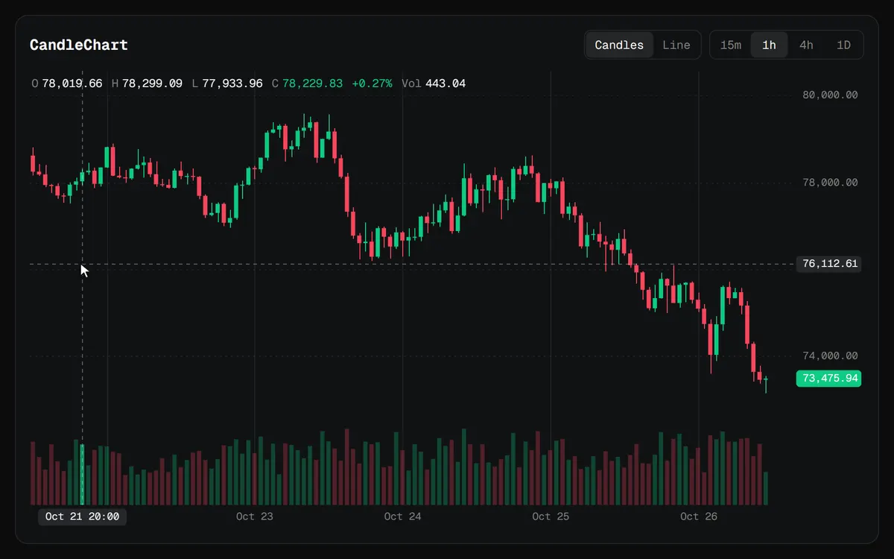

# CandleChart



A trading chart: candles or a close line, a volume pane, and the price axis on the right. The crosshair reads any bar into the legend, the wheel zooms around the pointer, a drag pans and keeps gliding when you let go, and dragging the price axis stretches prices.

```js
import { CandleChart } from "charts/candles";
import "charts/charts.css";

const chart = new CandleChart(document.querySelector("#chart"), {
  bars, // [{ time, open, high, low, close, volume }]
  visible: 120,
  label: "BTC/USDT, one hour candles. Scroll to zoom, drag to pan, drag the price axis to stretch it.",
});
```

## Options

| Option | Default | |
| --- | --- | --- |
| `bars` | required | `{ time, open, high, low, close, volume }[]`, oldest first. `time` is seconds since the epoch, UTC, at the bar's open. |
| `mode` | `"candles"` | `"candles"` or `"line"`, which draws the closes as a line with a soft fill. |
| `visible` | `120` | How many bars show at first. |
| `intraday` | bars shorter than a day | Whether time labels and the crosshair show the hour as well as the date. |
| `volume` | `true` | Whether to draw the volume pane. Without it, prices take the full height. |
| `format` | two decimals | How prices read on the axis, the tags and the legend. Prices below 0.1 keep four significant digits. |
| `label` | | The chart's accessible name. |
| `theme` | | Colours for this chart only, over the `--chart-*` variables. |
| `onHover` | | Called with the hovered bar's index, or `null`. |

## Methods

| Method | |
| --- | --- |
| `setBars(bars, visible?)` | New data. The view resets to the latest bars. |
| `setMode(mode)` | Switches between candles and a line. The view stays where it is. |
| `redraw()` | Paints again, for example after a theme change. |
| `destroy()` | Removes the canvas, listeners and observers. |

## Controls

| Input | Does |
| --- | --- |
| Wheel | Zooms time around the pointer. Zooming out stops once every bar fits. |
| Drag the plot | Pans, and glides on after a quick release. |
| Drag the price axis | Stretches or squeezes prices. **Auto** or a double-click on the axis fits them again. |
| Left and right arrows | Step the crosshair from bar to bar. |
| `+` and `-` | Zoom in and out, keeping the right edge of the view in place. |
| Escape | Clears the crosshair. |

Time labels land on round times: whole hours, midnights and weeks, depending on how far apart the bars are.

[Back to all charts](../README.md)
