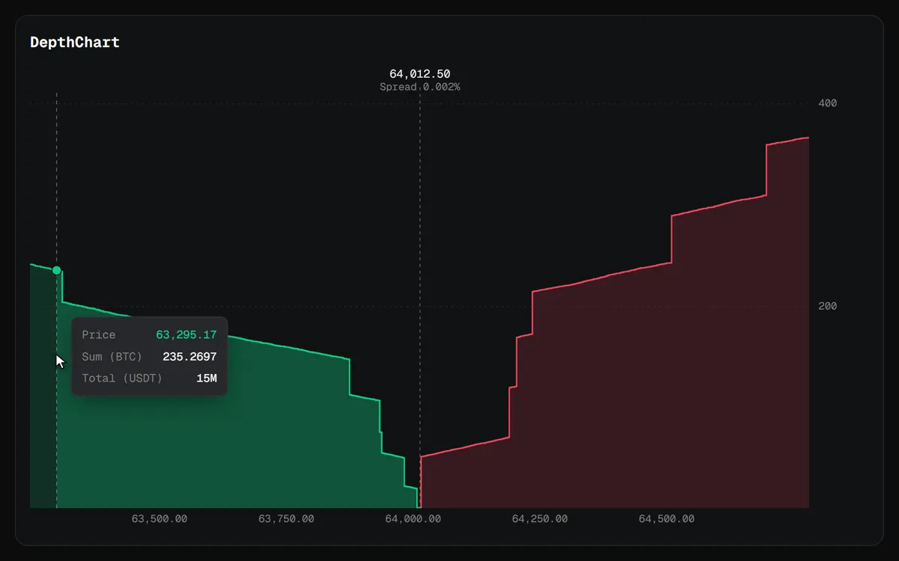

# DepthChart



An order book depth chart. Bids step down toward the mid price on the left and asks step up from it on the right, each showing the running total of size from the best price outward. Hover anywhere to read the price, the total size and its value at that point, and use the wheel to narrow or widen the band around the mid price.

```js
import { DepthChart } from "charts/depth";
import "charts/charts.css";

const chart = new DepthChart(document.querySelector("#depth"), {
  bids, // [[price, size], ...] in any order
  asks,
  base: "BTC",
  quote: "USDT",
  range: 0.01, // one percent either side of the mid price
});

socket.addEventListener("message", () => chart.setBook(book.bids, book.asks));
```

## Options

| Option | Default | |
| --- | --- | --- |
| `bids`, `asks` | required | `[price, size][]` in any order. Levels with no size are skipped. |
| `base`, `quote` | `"BASE"`, `"QUOTE"` | Names for the tooltip: the asset traded and the one it is priced in. |
| `range` | `0.01` | How far either side of the mid price to show, as a ratio. The wheel keeps it between 0.05% and 50%. |
| `formatPrice` | two decimals | How prices read. |
| `formatSize` | up to four decimals | How sizes read. Sizes from 10,000 up read as `12.5K`. |
| `label` | | The chart's accessible name. |
| `theme` | | Colours for this chart only, over the `--chart-*` variables. |

## Methods

| Method | |
| --- | --- |
| `setBook(bids, asks)` | New levels. The band stays where the reader left it. |
| `redraw()` | Paints again, for example after a theme change. |
| `destroy()` | Removes the canvas, listeners and observers. |

Two helpers are exported for use outside the chart. `accumulate(levels, side)` sorts one side from the best price outward and adds up `total` size and `notional` value as it goes. `depthAt(levels, price, side)` returns the depth reached at a price, or `null` before the best level.

## Controls

| Input | Does |
| --- | --- |
| Hover | Shows the price, `Sum` in the base asset and `Total` in the quote asset, and shades that side up to the pointer. |
| Wheel, `+` and `-` | Narrow or widen the band around the mid price. |

[Back to all charts](../README.md)
