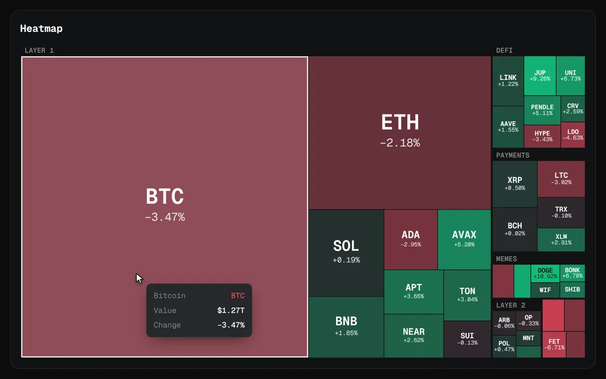

# Heatmap



A market heatmap. Each tile's area is its value and its colour is its change, deeper the further it moves. Tiles that share a group sit together under the group's name. Click a group to zoom into it and the tiles glide to their new places. Escape or the bar at the top zooms back out.

```js
import { Heatmap } from "charts/heatmap";
import "charts/charts.css";

const chart = new Heatmap(document.querySelector("#heatmap"), {
  tiles: [
    { id: "btc", label: "BTC", name: "Bitcoin", value: 1.27e12, change: -0.012, group: "Layer 1" },
    // ...
  ],
  onSelect: (tile) => openCoin(tile.id),
});
```

## Options

| Option | Default | |
| --- | --- | --- |
| `tiles` | required | `{ id, label, name?, value, change, group? }[]`. `value` sets the area, `change` the colour as a ratio (`-0.04` is down 4%), and `name` shows in the tooltip. |
| `maxChange` | `0.1` | The change at which colour stops getting deeper. |
| `formatValue` | `$1.27T` | How values read in the tooltip. |
| `label` | | The chart's accessible name. |
| `theme` | | Colours for this chart only, over the `--chart-*` variables. |
| `onSelect` | | Called with a tile clicked while zoomed into its group, or any tile when there are no groups. |

## Methods

| Method | |
| --- | --- |
| `setTiles(tiles)` | New tiles. Tiles that stay glide to their new places; new ones fade in. |
| `tileRect(id)` | Where a tile sits once any zoom settles, in CSS pixels from the chart's top left, or `null` when it is off screen. Use it to anchor a popover to a tile. |
| `redraw()` | Paints again, for example after a theme change. |
| `destroy()` | Removes the canvas, listeners and observers. |

`squarify(items, rect)` is exported too. It lays out anything with a `value` in a rectangle, areas in proportion, keeping each tile as close to square as it can (the squarified treemap of Bruls, Huizing and van Wijk).

## Controls

| Input | Does |
| --- | --- |
| Hover | Shows the tile's name, value and change. |
| Click a tile | Zooms into its group, or calls `onSelect` once zoomed in. |
| Click the bar at the top, or Escape | Zooms back out. |

[Back to all charts](../README.md)
