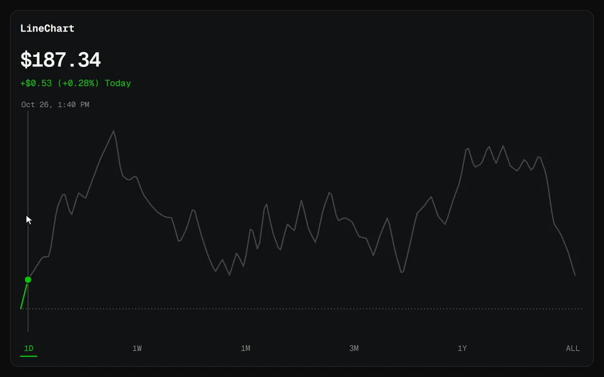

# LineChart



A price line with no axes and no grid. It is green when the value is up on the reference and orange-red when it is down. Drag across it to read any point: the part ahead of the hairline fades, and `onScrub` hands you the point so the page can update its headline number. Changing the data morphs the old line into the new one.

```js
import { LineChart } from "charts/line";
import "charts/charts.css";

const usd = new Intl.NumberFormat("en-US", { style: "currency", currency: "USD" });

const chart = new LineChart(document.querySelector("#line"), {
  points, // [{ time, value }]
  reference: previousClose,
  live: true,
  onScrub: (state) => {
    const point = state ? state.point : points.at(-1);
    price.textContent = usd.format(point.value);
  },
});

rangeButton.addEventListener("click", () => chart.setData(weekPoints, weekPoints[0].value));
```

## Options

| Option | Default | |
| --- | --- | --- |
| `points` | required | `{ time, value }[]`, oldest first. `time` is seconds since the epoch, UTC. |
| `reference` | the first point | What the change is measured from, such as yesterday's close. Drawn as a dotted line. |
| `showReference` | `true` with a `reference` | Whether to draw the dotted line. |
| `live` | `false` | A pulsing dot on the last point, for a line that is still moving. |
| `format` | two decimals | How values read. |
| `formatTime` | `Oct 26, 8:00 PM` | How a point's time reads above the hairline. |
| `label` | | The chart's accessible name. |
| `theme` | `#00c805` up, `#ff5000` down | Colours for this chart only. The line uses its own brighter green and orange-red unless you pass `up` and `down`. |
| `onScrub` | | Called with `{ index, point, change }` while the reader scrubs, and with `null` when they stop. `change` is a ratio: `0.012` is +1.2%. |

## Methods

| Method | |
| --- | --- |
| `setData(points, reference?)` | New data. The line morphs from what is on screen into the new shape. |
| `redraw()` | Paints again, for example after a theme change. |
| `destroy()` | Removes the canvas, listeners and observers. |

`resample(values, n)` is exported too: it stretches or squeezes a list of numbers to exactly `n` by linear interpolation, which is how two lines of different lengths blend point for point.

## Controls

| Input | Does |
| --- | --- |
| Move or drag across the line | Scrubs to the nearest point. |
| Left and right arrows | Step one point, or ten with Shift. |
| Home and End | Jump to the first or last point. |
| Escape | Lets go of the line. |

[Back to all charts](../README.md)
